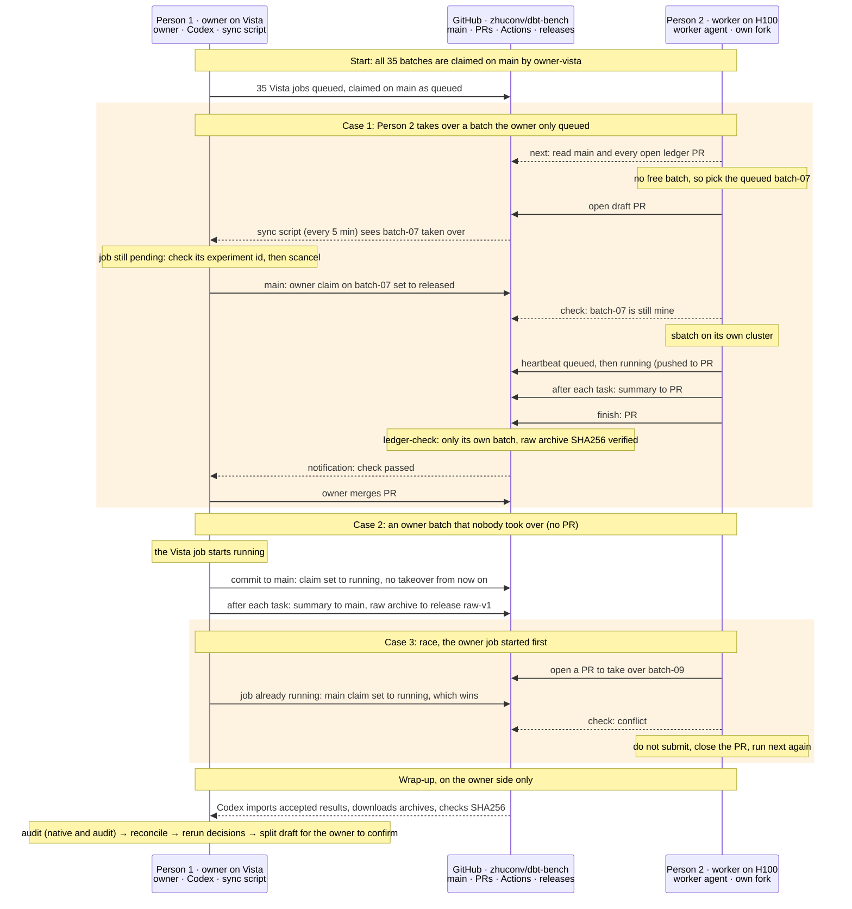

# Distributed workers

Several people run measurement batches on their own servers. The diagram shows what happens to a batch between three places:

- Person 1, the experiment owner on TACC Vista: the owner, Codex and a sync script run by Claude.
- GitHub (this repository): `main`, ledger pull requests, the `ledger-check` workflow and releases.
- Person 2, a worker on its own H100 server: an agent following [AGENTS.md](../AGENTS.md), with its own fork.

Person 1 and Person 2 never talk to each other directly. Every claim, result and acceptance goes through GitHub. In the diagram:

- solid arrows write or act;
- dashed arrows read or notify;
- shaded blocks are the takeover and the race.

## Who holds a batch

The rules below are applied in order:

1. When every task of the batch has a summary on `main`, the batch is finished.
2. Otherwise a running claim holds it.
3. Otherwise a fresh `claimed` claim on `main` holds it.
4. Otherwise the lowest-numbered open ledger PR holds it. This is how a worker takes over a batch the owner has only queued. The owner's sync script then cancels the pending Vista job and releases the owner claim.

The rules are implemented in `scripts/worker.py`. The ledger layout is in [ledger/README.md](../ledger/README.md), and the PR check is `scripts/ledger_check.py`. Merging a PR accepts its raw results only; joint native and audit success is decided centrally afterwards.
